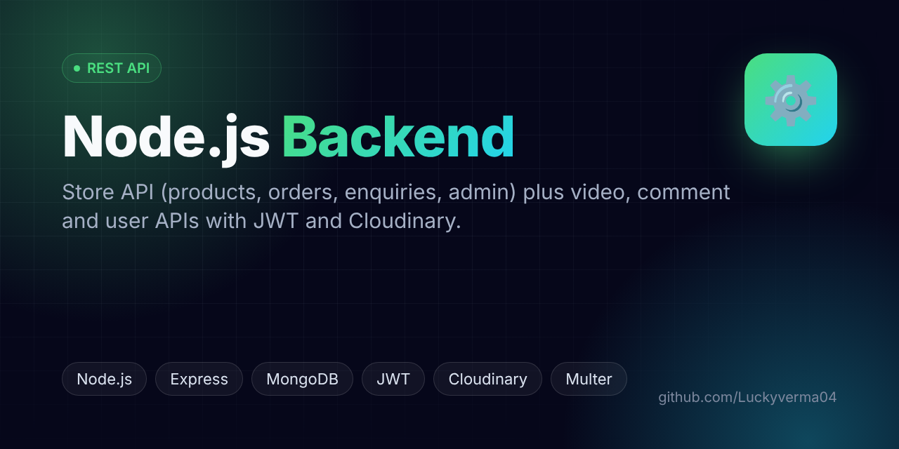

<div align="center">



# ⚙️ Node.js Backend

REST API built with **Node.js, Express and MongoDB**. It powers the **[Patel Corp Gifts](https://github.com/Luckyverma04/Major_Project2)** store (products, orders, enquiries, admin) and also has a video-platform module (users, videos, comments) I built while learning backend development.


</div>

---

## ✨ Features

- **Users:** register with avatar + cover image (Cloudinary), login / logout, **access + refresh tokens** in cookies, change password, update profile, channel page, watch history
- **Store:** products with categories, filters and images; orders with payment status (`pending / paid / failed / refunded`) and order status (`pending → confirmed → processing → shipped → delivered`, or `cancelled`); bulk-order **enquiries**
- **Admin:** separate admin login, user search, roles (`user / admin / moderator`), user status, product stats, dashboard stats
- **Videos & comments:** list, publish / unpublish, update, delete videos; add, list and update comments
- Pagination with `mongoose-aggregate-paginate-v2`, central error and response helpers, health check at `/api/v1/health`

## 🔌 API reference

Base: `/api/v1` · 🔒 user JWT · 👑 admin JWT

### Users – `/users`
| Method | Endpoint | Description |
|---|---|---|
| POST | `/register` · `/login` · `/refresh-token` | Sign up (with avatar), login, new access token |
| POST 🔒 | `/logout` · `/change-password` | Logout, change password |
| GET 🔒 | `/current-user` · `/c/:username` · `/watch-history` | Me, channel profile, history |
| PATCH 🔒 | `/update-account` · `/avatar` · `/cover-image` | Update profile and images |

### Products
| Method | Endpoint | Description |
|---|---|---|
| GET | `/products` · `/products/:id` · `/products/category/:category` | Browse products |
| POST 👑 | `/createProduct` | Add a product (with image) |
| PUT / DELETE 👑 | `/products/update/:id` · `/products/delete/:id` | Edit / delete |

### Orders – `/orders`
| Method | Endpoint | Description |
|---|---|---|
| POST 🔒 | `/` | Place an order |
| GET 🔒 | `/my-orders` · `/:orderId` | My orders |
| GET 👑 | `/` | All orders |
| PUT 👑 | `/:orderId/status` | Update order status |

### Enquiries – `/enquiries`
| Method | Endpoint | Description |
|---|---|---|
| POST | `/` | Send a bulk-order enquiry |
| GET / PUT / DELETE 👑 | `/` · `/:id` | Manage enquiries |

### Admin – `/admin` 👑
`POST /login`, `POST /logout`, `GET /users`, `GET /users/search`, `GET|PATCH|DELETE /users/:id`, `PUT /users/role`, `PUT /users/status`, `GET /products/stats`, `GET /stats`

### Videos & comments – `/videos`, `/comments` 🔒
`GET /videos/getAllVideos`, `GET /videos/getVideoById/:id`, `POST /videos/publish/:id`, `POST /videos/unpublish/:id`, `PATCH /videos/updateVideo/:id`, `DELETE /videos/deleteVideo/:id`, `GET /comments/videoComments/:videoId`, `POST /comments/addComments/:videoId`, `PATCH /comments/updateComments/:commentId`

## 🚀 Run locally

```bash
git clone https://github.com/Luckyverma04/backend.git
cd backend
npm install
cp .env.sample .env      # then fill in the values
npm run dev              # http://localhost:8000/api/v1/health
```

### Environment variables

| Key | Description |
|---|---|
| `MONGODB_URI` · `DB_NAME` | MongoDB connection and database name |
| `PORT` | Default `8000` |
| `CORS_ORIGIN` | Frontend URL |
| `ACCESS_TOKEN_SECRET` · `ACCESS_TOKEN_EXPIRY` | Access token |
| `REFRESH_TOKEN_SECRET` · `REFRESH_TOKEN_EXPIRY` | Refresh token |
| `CLOUDINARY_CLOUD_NAME` · `CLOUDINARY_API_KEY` · `CLOUDINARY_API_SECRET` | Image uploads |
| `EMAIL_USER` · `EMAIL_PASS` | Emails (Nodemailer) |

## 📁 Project structure

```
src/
├── index.js / app.js     # server, CORS, cookies, routes
├── db/                   # MongoDB connection
├── controllers/          # user, admin, product, order, enquiry, video, comment, tweet
├── models/               # User, Product, Order, Enquiry, Video, Comment, Like, Playlist, Subscription, Tweet
├── routes/
├── middlewares/          # JWT auth, admin auth, multer
└── utils/                # ApiError, ApiResponse, asyncHandler, cloudinary, sendEmail
```

---

## 🖼️ Image links

| Image | Link |
|---|---|
| Banner | https://raw.githubusercontent.com/Luckyverma04/backend/main/docs/banner.png |

<div align="center">

By **[Lucky Verma](https://github.com/Luckyverma04)**

</div>
